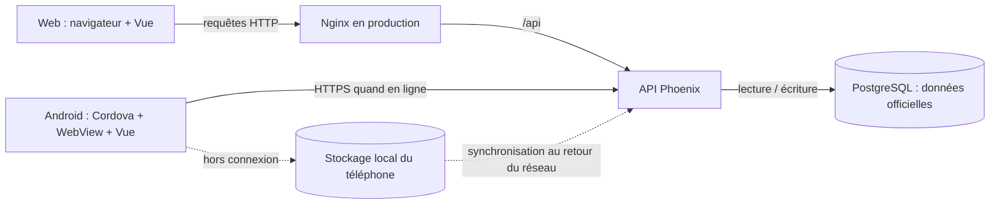

# Comprendre Time Manager : le fonctionnement, pas à pas

Ce guide explique **pourquoi les composants existent, comment ils se parlent et
ce qui se passe réellement** lorsqu'une personne se connecte ou pointe. L'idée
est de pouvoir raconter le système sans devoir réciter les noms des fichiers.

## Le projet en une image

Time Manager est un carnet de temps partagé :

- les personnes utilisent un navigateur ou l'application Android ;
- les deux interfaces demandent des opérations à un serveur ;
- le serveur vérifie qui fait la demande et si cette personne en a le droit ;
- il enregistre les données officielles dans PostgreSQL ;
- le téléphone peut garder temporairement des pointages s'il n'a pas de réseau,
  puis les transmettre plus tard.



La règle fondamentale est : **le web et le mobile sont deux portes d'entrée
vers le même serveur et les mêmes données**. Le téléphone ne devient pas le
serveur lorsque le réseau disparaît : il conserve temporairement une file
d'événements à transmettre.

## 1. Qui fait quoi ?

| Élément | Explication sans jargon |
| --- | --- |
| **Frontend / client** | L'écran utilisé par la personne. Il affiche les données, recueille les actions et demande au serveur de travailler. |
| **API** | La porte d'entrée du serveur. Elle reçoit des demandes précises (« donne mon historique », « enregistre ce pointage ») et renvoie une réponse. |
| **Backend / serveur** | Le programme qui applique les règles : authentifier la personne, vérifier ses droits, valider les données et coordonner leur sauvegarde. |
| **Base de données** | Le rangement central et durable des comptes, horaires, pointages, équipes et autres informations. |
| **Navigateur** | Le programme qui ouvre le site web. |
| **WebView** | Un navigateur intégré dans une application mobile. Cordova fournit ce conteneur à Android. |
| **Réseau / Internet** | Le moyen de transport entre le client et le serveur. Sans lui, une requête ne peut pas atteindre l'API. |

Dans ce projet, le frontend est développé avec **Vue 3** ; l'API avec
**Elixir/Phoenix** ; la base centrale est **PostgreSQL** ; **Cordova** transforme
le frontend en application Android. Ces choix répondent à des besoins distincts :
interface réutilisable, serveur qui porte les règles, données persistantes et
accès aux fonctions du téléphone.

## 2. Vocabulaire à comprendre

### API et API REST

**API** signifie *Application Programming Interface*. C'est un contrat de
communication entre programmes. L'interface ne demande pas « exécute ce code
Elixir » : elle envoie une demande web connue du serveur.

Exemples conceptuels :

- `GET /api/users/12/working-times` : lire les horaires de la personne 12 ;
- `POST /api/users/12/clocks` : demander l'enregistrement d'un pointage.

Une API **REST** utilise les opérations web usuelles : `GET` pour lire, `POST`
pour créer ou déclencher, `PUT` pour remplacer/modifier, `PATCH` pour une
modification partielle, `DELETE` pour supprimer. Le chemin identifie la
ressource et la méthode exprime l'action. Phoenix reçoit ces demandes et
retourne généralement du **JSON**, un format texte structuré que JavaScript et
Elixir savent lire.

Les réponses ont également un code HTTP. Par exemple :

- `200` : demande traitée ;
- `201` : ressource créée ;
- `401` : pas d'identité valide (non connecté, jeton expiré ou invalide) ;
- `403` : identité reconnue, mais action interdite ou protection CSRF refusée ;
- `404` : ressource absente ;
- `409` : conflit d'état, par exemple une deuxième entrée alors qu'une session
  est déjà ouverte.

### JWT

**JWT** (*JSON Web Token*) est un jeton signé que le client peut présenter pour
prouver son identité. On peut le voir comme un badge numérique :

1. après vérification du mot de passe, le serveur fabrique et signe le badge ;
2. le client le présente aux demandes protégées ;
3. le serveur vérifie la signature et l'expiration, puis retrouve le compte.

Le JWT de ce projet contient notamment l'identifiant et le rôle de l'utilisateur
ainsi qu'une valeur CSRF. Sa durée de validité configurée est de 24 heures.
**Un JWT n'est pas un mot de passe, ni un chiffrement** : ses informations ne
doivent pas être supposées secrètes ; la signature sert à détecter une
falsification. Sa protection repose notamment sur la façon de le transporter
et de le stocker.

### Cookie, `HttpOnly` et `Bearer`

Un **cookie** est une petite valeur que le navigateur conserve et renvoie au
même serveur lors des prochaines requêtes. `HttpOnly` signifie que le
JavaScript de la page ne peut pas lire ce cookie. Dans le parcours web, le JWT
est placé dans le cookie `auth_token` : le navigateur le joint
automatiquement à la demande.

Le **Bearer token** est une autre façon de présenter le même type de jeton :
le client ajoute un en-tête HTTP `Authorization: Bearer …`. L'app Android lit
son jeton depuis le stockage sécurisé natif, puis l'envoie de cette façon.
Cookie et Bearer sont deux modes de transport de la preuve d'identité ; Phoenix
sait vérifier l'un ou l'autre.

### CSRF et XSRF (et non « XRFT »)

**CSRF** (*Cross-Site Request Forgery*) décrit une attaque où un site malveillant
essaie de faire effectuer une action à un navigateur déjà connecté sur un autre
site. **XSRF** est un autre nom souvent utilisé pour la même protection. Le nom
employé ici est `c-xsrf-token` pour le cookie et `x-xsrf-token` pour l'en-tête.

Pourquoi faut-il une protection supplémentaire si le JWT est signé ? Parce que
le navigateur renvoie les cookies automatiquement. Le serveur exige donc,
pour les actions qui modifient les données, une deuxième valeur que le site
tiers ne peut normalement pas lire :

1. le client renvoie le cookie d'authentification ;
2. il envoie aussi le jeton CSRF dans l'en-tête `x-xsrf-token` ;
3. Phoenix compare cet en-tête à la valeur CSRF incluse dans le JWT ;
4. si l'un manque ou ne correspond pas, la demande est refusée.

CSRF ne signifie pas que le mot de passe est mauvais : c'est une vérification
supplémentaire contre les demandes forgées depuis un autre site. Le code utilise
la même vérification pour les demandes mobiles munies d'un Bearer token.

### Autres termes utiles

| Terme | Sens pratique |
| --- | --- |
| **SPA** | Site dont les écrans sont rendus dans le navigateur, sans recharger une page HTML complète à chaque navigation. Vue gère les écrans de Time Manager. |
| **JSON** | Format de données échangé dans les demandes et réponses de l'API. |
| **TLS / HTTPS** | Chiffrement du trajet réseau entre client et serveur. HTTPS protège les données en transit ; il ne remplace ni l'authentification ni les contrôles de droits. |
| **CORS** | Règle du navigateur qui décide si une page d'une origine donnée peut appeler une API située ailleurs. Ce n'est pas un mécanisme de connexion. |
| **SQLite** | Petite base embarquée, utile sur un appareil pour conserver une file hors ligne. Elle n'est pas la base centrale de l'entreprise. |
| **Transaction** | Groupe d'opérations en base qui réussissent ou échouent ensemble. Ici, le pointage et la mise à jour de la session doivent rester cohérents. |
| **Idempotence** | Propriété d'une répétition sans effet en double. L'identifiant client d'un pointage aide le serveur à reconnaître une retransmission. |
| **Migration** | Changement versionné du schéma de la base, comme l'ajout d'une table ou d'une colonne. |
| **APK** | Fichier installable Android produit à partir du frontend, de Cordova et de la plateforme Android. |

## 3. Comment le web parle à l'API

### En développement

```text
Navigateur (Vue) → serveur de développement Vite → API Phoenix sur localhost:4000
```

Le navigateur envoie une demande à `/api/...`. Vite, utilisé comme serveur de
développement, relaie ce chemin vers Phoenix sur le port 4000. Ce **proxy** évite
de devoir construire une version de production à chaque modification et
simplifie la communication entre les deux serveurs pendant le développement.

### Dans le déploiement Docker décrit par le dépôt

```text
Navigateur → Nginx (port publié 8080) → Phoenix (réseau Docker) → PostgreSQL
```

Nginx sert les fichiers Vue et relaie les chemins `/api/` au service `api`.
L'utilisateur utilise donc le même point d'entrée web pour les fichiers et
l'API. Le navigateur n'a pas besoin d'accéder directement à PostgreSQL, et le
port 4000 de l'API n'est pas publié directement par le Compose racine.

Ce montage fait de **Nginx un reverse proxy** : il reçoit une demande destinée
au système, puis la transmet au bon service interne. En développement, c'est
Vite qui joue le rôle de relais ; dans Compose, c'est Nginx.

### Exemple : charger l'historique sur le web

1. Vue demande `GET /api/users/12/working-times`.
2. Axios ajoute les cookies disponibles au navigateur.
3. En production, Nginx transmet la demande à Phoenix ; en développement, Vite
   la transmet à Phoenix.
4. Le routeur Phoenix choisit la route. Le plug d'authentification vérifie le
   JWT ; le contrôle d'accès vérifie que l'utilisateur peut consulter l'ID 12.
5. Le contrôleur demande les horaires à la couche métier, qui lit PostgreSQL.
6. Phoenix renvoie un JSON ; Vue le transforme en lignes, cartes ou graphiques.

### Exemple : faire un pointage sur le web

Le client web envoie une opération mutante, ici une requête `POST`. Le navigateur
joint son cookie `auth_token` ; Axios ajoute le jeton CSRF dans l'en-tête. Le
serveur valide la session, le jeton CSRF, les droits et l'état du pointage.
S'il accepte, il sauvegarde le clock et crée ou ferme le workingtime dans une
transaction. La réponse permet à Vue de rafraîchir l'écran.

Le navigateur n'écrit **jamais directement** dans PostgreSQL. Il demande une
action à l'API, qui applique la règle puis écrit dans la base.

## 4. Connexion : parcours web et parcours Android

### Connexion sur le web

1. La personne saisit son e-mail et son mot de passe dans Vue.
2. Vue envoie `POST /api/auth/sign_in` à Phoenix.
3. Le backend vérifie le mot de passe avec son hash Bcrypt et vérifie que le
   compte est utilisable.
4. Il fabrique un JWT et une valeur CSRF.
5. Il met le JWT dans `auth_token` (cookie `HttpOnly`) et la valeur CSRF dans le
   cookie lisible `c-xsrf-token`.
6. Le frontend conserve un résumé public (identifiant, nom, rôle) pour afficher
   la bonne navigation. Ce résumé **n'est pas la preuve serveur de connexion**.
7. Aux requêtes suivantes, le navigateur renvoie les cookies. Phoenix revalide
   le JWT. `GET /api/auth/me` sert notamment à confirmer l'identité côté serveur.

**Pourquoi mettre le JWT dans un cookie HttpOnly sur le web ?** Cela empêche le
JavaScript de la page de lire directement le secret de session. Le cookie étant
envoyé automatiquement, la protection CSRF est nécessaire pour les actions
mutantes.

### Connexion sur Android

1. Cordova ouvre l'application Vue dans une WebView.
2. Vue envoie les mêmes identifiants au même endpoint de connexion.
3. Phoenix constate l'origine mobile configurée (`https://localhost`). En plus
   des cookies de réponse, il renvoie le JWT et la valeur CSRF dans le JSON afin
   que le client mobile puisse les sauvegarder.
4. Le plugin de stockage sécurisé garde ces secrets dans le stockage natif
   réservé à l'application. Le résumé public du compte reste séparé.
5. Aux requêtes suivantes, Axios lit les secrets depuis ce plugin et envoie
   `Authorization: Bearer …` ainsi que `x-xsrf-token`.
6. Phoenix vérifie le Bearer token, le jeton CSRF et les droits comme pour le web.

**Pourquoi deux parcours ?** Les navigateurs savent gérer facilement des
cookies HttpOnly ; une application native a besoin d'un moyen explicite de
conserver son jeton et de l'envoyer. Les deux clients ont donc des mécanismes
de transport différents, mais réutilisent le même backend, les mêmes règles
métier et la même base.

Si Phoenix répond `401`, l'intercepteur Axios retire la session locale et
renvoie l'utilisateur vers l'écran de connexion. Une réponse `403` signifie
plutôt que la demande est refusée (droits ou CSRF) ; ce n'est pas équivalent à
une session absente.

## 5. Android avec Cordova : à quoi sert chaque couche ?

**Cordova** est un pont entre une interface web et une application native. Il
emballe les fichiers HTML/CSS/JavaScript de Vue dans une application Android,
affichée par une **WebView**, et fournit des **plugins** qui exposent certaines
fonctions du téléphone au JavaScript.

Dans ce projet :

- Vue construit les écrans et la logique de pointage ;
- la WebView affiche cette interface ;
- Cordova fournit le cycle de vie et le pont vers Android ;
- les plugins ajoutent stockage sécurisé, SQLite, état réseau, notifications,
  vibration et informations appareil ;
- le backend continue d'être l'autorité pour les comptes et les horaires
  officiels.

Cordova n'est donc ni l'API ni la base de données. C'est le conteneur mobile et
le lien vers des fonctions Android. Le même frontend peut servir le web et le
mobile, avec une branche de comportement lorsque Cordova est détecté.

### Parcours mobile en ligne : connexion puis pointage

```text
Utilisateur
  → Vue dans la WebView
  → Axios prépare JWT Bearer + jeton CSRF
  → Internet / HTTPS
  → API Phoenix authentifie et applique les règles
  → PostgreSQL enregistre le pointage
  ← réponse de l'API
  ← Vue actualise l'écran et affiche « synchronisé »
```

En détail :

1. À l'ouverture, l'application vérifie le réseau et charge les horaires auprès
   de l'API.
2. Elle conserve localement une copie des horaires reçus pour consultation
   ultérieure.
3. Au toucher de `Clock In` ou `Clock Out`, elle crée un événement avec le type,
   l'heure et un identifiant unique généré sur l'appareil.
4. Elle inscrit l'événement dans la file locale, puis essaie tout de suite de le
   transmettre s'il y a du réseau.
5. Phoenix authentifie la requête, vérifie le CSRF et vérifie que la transition
   est valide : on ne peut pas commencer une deuxième session ouverte, ni
   fermer une session qui n'existe pas.
6. Le serveur enregistre l'événement `clock` et crée/ferme la session
   `workingtime` dans une transaction.
7. À la réussite, le téléphone retire l'événement de sa file et affiche la
   confirmation de synchronisation.

Un **clock** est l'événement ponctuel « entrée » ou « sortie ». Un
**workingtime** est l'intervalle de travail qui commence à l'entrée et se
termine à la sortie. Conserver ces deux notions permet de garder les événements
et de consulter/calculer des périodes de travail.

### Parcours mobile hors ligne

```text
Le réseau tombe
  → le téléphone connaît déjà l'état/copie des horaires ?
      non : il demande une première connexion réseau avant d'autoriser le pointage
      oui : il enregistre l'événement dans SQLite localement
  → Vue affiche le pointage comme « en attente »
  → le réseau revient
  → la file envoie les événements à Phoenix
  → PostgreSQL devient à jour
  → les événements confirmés sont retirés de SQLite
```

Plus précisément :

1. **Il faut connaître l'état initial.** Avant d'autoriser un pointage hors
   ligne, l'écran doit avoir chargé une fois l'état des horaires depuis le
   serveur, ou disposer d'un événement local en attente. Une installation neuve
   sans aucun état serveur ne sait pas de façon fiable si une session est déjà
   ouverte.
2. **L'action est mise en file localement.** Sur Cordova, SQLite stocke chaque
   événement. Si SQLite n'est pas disponible (par exemple dans certains tests
   ou un navigateur), le service utilise `localStorage` comme solution de
   repli. `localStorage` n'est pas un stockage sécurisé pour des jetons ; il
   s'agit ici de la file de pointages de secours.
3. **L'interface montre l'état optimiste.** Elle applique l'événement en attente
   à l'historique affiché pour que l'utilisateur voie son action, mais indique
   qu'elle n'est pas encore confirmée par le serveur.
4. **La base centrale n'est pas encore modifiée.** Tant qu'il n'y a pas de
   réponse de Phoenix, l'événement reste local. Réinstaller ou perdre les
   données de l'application avant synchronisation peut donc faire perdre des
   événements non transmis ; il faut les synchroniser avant de changer
   d'appareil.
5. **Au retour du réseau**, l'application détecte l'état en ligne et parcourt
   les événements en attente dans l'ordre de leur heure. Elle les envoie un à
   un.
6. **Le serveur reconnaît une retransmission.** Chaque envoi garde le même
   `client_event_id`. Si le serveur a déjà enregistré cet événement mais que la
   réponse s'est perdue, un nouvel envoi avec le même identifiant évite de
   créer un deuxième pointage identique.
7. **En cas d'échec**, l'événement reste enregistré avec un statut d'échec, un
   nombre de tentatives et un message. Il pourra être retenté quand la
   synchronisation sera relancée. Un `401` indique par exemple que le jeton a
   expiré : l'utilisateur devra se reconnecter avant qu'un événement protégé
   puisse être accepté.

Le stockage local améliore la continuité, mais ne transforme pas l'application
en système totalement hors ligne : seules les données déjà mises en cache et
les actions prévues pour la file locale restent disponibles. Les autres
fonctions, comme consulter des données jamais téléchargées ou soumettre une
demande au serveur, nécessitent une connexion.

### Pourquoi SQLite sur le téléphone et PostgreSQL sur le serveur ?

- **SQLite** fonctionne localement, sans serveur et sans réseau. Il convient à
  une petite file d'attente ou à un cache associé à un appareil.
- **PostgreSQL** est centralisé, partagé entre tous les appareils et sauvegardé
  par le serveur. Il contient la version officielle des données.

Au retour du réseau, les données pertinentes remontent vers PostgreSQL. Il ne
s'agit pas de fusionner toute la base mobile avec toute la base serveur : le
mobile transmet des événements de pointage définis, et l'API décide s'ils sont
acceptables.

## 6. Pourquoi l'API et la base sont séparées ?

On pourrait imaginer un écran qui écrit directement dans une base de données,
mais ce serait une mauvaise frontière :

- il faudrait distribuer les accès à la base dans le navigateur et sur chaque
  téléphone ;
- les règles pourraient être contournées en modifiant le client ;
- plusieurs clients risqueraient de calculer ou d'enregistrer des données de
  façon différente ;
- l'application mobile devrait connaître le schéma interne de la base.

L'API joue donc le rôle de **guichet et d'arbitre**. Elle reçoit toutes les
demandes, contrôle l'identité et les droits, valide les valeurs et protège la
cohérence métier. PostgreSQL garde les données ; l'API seule organise les
lectures et écritures.

Dans l'API, les rôles `employee`, `manager` et `admin` n'ont pas les mêmes
autorisations. Le frontend peut cacher les boutons inutiles, mais Phoenix
revérifie les permissions : cacher un bouton n'est jamais une barrière de
sécurité.

## 7. Le backend : pourquoi Elixir/Phoenix/PostgreSQL ?

- **Elixir** est le langage utilisé pour écrire le serveur.
- **OTP** désigne la plateforme d'exécution d'Elixir/Erlang : elle aide à
  démarrer, surveiller et redémarrer des composants serveur.
- **Phoenix** fournit le serveur web et l'organisation des routes, contrôleurs
  et réponses JSON.
- **Ecto** fait le lien entre le code Elixir et la base : il traduit les
  demandes en requêtes, valide les valeurs et gère les migrations.
- **PostgreSQL** conserve les informations de façon durable et permet de relier
  proprement les utilisateurs, équipes, demandes et pointages.
- **Bcrypt** transforme le mot de passe en empreinte difficile à inverser. Le
  serveur compare une tentative de connexion à cette empreinte ; il n'a pas
  besoin de garder le mot de passe en clair.
- **OpenAPI/Swagger** décrit les routes de l'API et permet de les inspecter.

Le trajet dans le serveur est : **route → contrôles transversaux → contrôleur →
règle métier → Ecto → PostgreSQL**, puis la réponse revient sous forme JSON.
Une migration décrit l'évolution de la structure de la base ; elle permet à
chaque environnement de créer les mêmes tables dans le bon ordre.

La base comprend notamment les comptes, les clocks, les workingtimes, les
équipes, les tâches, les demandes de congé, les corrections de pointage, les
notifications et les politiques/règles de travail.

## 8. Docker et Docker Compose

### Docker : le paquet reproductible

**Docker** permet d'emballer un programme et ce dont il a besoin dans une
**image**. Quand l'image tourne, on parle d'un **conteneur**. On peut comparer
l'image au modèle d'un appareil et le conteneur à une instance démarrée depuis
ce modèle.

Pourquoi ? Le serveur n'a pas besoin d'installer manuellement Elixir, Node et
toutes les dépendances sur la machine de production. On construit une image,
puis on démarre cette même version dans un environnement reproductible.

Le Dockerfile de l'API compile une release Elixir dans une étape de
construction, puis copie seulement le nécessaire dans une image d'exécution
plus petite. Celui du frontend compile Vue avec Node, puis copie les fichiers
statiques dans Nginx. Nginx sert les pages ; Node ne sert pas le site en
production.

### Docker Compose : plusieurs conteneurs coordonnés

**Docker Compose** décrit un petit système composé de plusieurs conteneurs :

| Service Compose | Travail |
| --- | --- |
| `db` | Lance PostgreSQL et conserve ses données dans un volume Docker. |
| `api` | Lance Phoenix et attend que la base réponde à son contrôle de santé. |
| `front` | Lance Nginx, sert Vue sur le port publié `8080` et relaie `/api` vers Phoenix. |

Compose crée un réseau privé entre ces services. Ils peuvent se joindre par
leurs noms (`api`, `db`) ; l'utilisateur extérieur accède au frontend via le
port publié. Le **volume** `pgdata` est un espace persistant : remplacer le
conteneur PostgreSQL ne supprime pas les données du volume. En revanche,
supprimer ce volume supprimerait la base.

**Résumé : Docker fabrique et exécute les paquets ; Compose décrit comment
plusieurs paquets démarrent ensemble et communiquent.**

Dans le dépôt, les services racine sont définis dans
[docker-compose.yml](./docker-compose.yml). Le fichier `.env` nécessaire n'est
pas commité, car il contient des valeurs de configuration et potentiellement
des secrets. En production, Phoenix requiert notamment `DATABASE_URL` et
`SECRET_KEY_BASE` ; la clé JWT doit elle aussi être définie explicitement. La
configuration Compose doit transmettre à l'API les variables requises, et
`DATABASE_URL` doit désigner `db` sur le réseau Compose.

Le Compose racine publie Nginx sur `8080`, mais ne configure pas à lui seul un
certificat HTTPS. HTTPS doit être fourni par l'infrastructure qui expose le
service. Le client Android utilise une URL HTTPS définie dans
`frontend/.env.mobile` ; l'URL accessible publiquement et le routage HTTPS
doivent donc être configurés en cohérence avec l'hébergement.

## 9. Travis CI, CI/CD et GitHub Actions

### CI/CD en langage courant

**CI** (*intégration continue*) signifie que le projet vérifie automatiquement
des changements : compiler et lancer les tests, par exemple.

**CD** (*livraison/déploiement continu*) automatise ensuite la préparation et la
mise en ligne d'une version. Un **pipeline** est une suite d'étapes ordonnées,
comme une chaîne de contrôle avant publication.

### Rôle de Travis dans ce dépôt

Travis CI est configuré dans `.travis.yml`. Pour une modification, il peut :

1. démarrer PostgreSQL et lancer les tests backend Elixir ;
2. installer les dépendances JavaScript et lancer les tests frontend ;
3. sur un push sur `main`, construire les images Docker de l'API et du frontend ;
4. les envoyer au registre Docker Hub avec le SHA du commit et l'étiquette `latest` ;
5. se connecter à la VM par SSH, copier le Compose, télécharger les nouvelles
   images et redémarrer les conteneurs.

Les identifiants Docker et la clé SSH doivent être enregistrés comme secrets
dans la configuration CI, et non dans le dépôt. Une raison d'automatiser cela :
chaque déploiement suit la même procédure et peut être relié au commit qui l'a
produit. Dans ce pipeline, la génération de l'APK Android n'est pas incluse.

### Rôle de GitHub Actions

Le workflow `.github/workflows/mirror.yml` ne déploie pas l'application : il
réplique les branches et tags Git vers un dépôt miroir. Il répond donc à un
besoin de copie/synchronisation du code, séparé de la livraison des services.

`time_manager_devops/hello/` contient un autre petit projet Phoenix de type
modèle/exercice. Ses fichiers Fly.io et ses Dockerfiles ne sont pas le pipeline
principal de Time Manager. Le déploiement actif documenté par le dépôt est le
Compose racine et le pipeline Travis.

## 10. Construire l'application Android et le rôle de l'APK

Le code source des écrans reste dans `frontend/`. La commande
`npm run build:mobile` compile ces écrans pour le mode Cordova et copie le
résultat dans `mobile/www/`. Puis Cordova et les outils Android assemblent les
fichiers web, la WebView et les plugins en un APK.

```text
frontend/src (code Vue)
  → build Vite en mode mobile
  → mobile/www (fichiers web compilés)
  → Cordova + plateforme Android + plugins
  → APK installable
```

L'APK est le produit final distribuable, pas l'endroit où l'on modifie les
écrans. Pour la construire, il faut Node.js, Cordova, un JDK, le SDK Android et
Gradle compatible. Une version destinée à une vraie distribution doit aussi
suivre le processus de signature Android. Les APK déjà présents dans le dépôt
peuvent provenir d'une ancienne compilation.

## 11. Que se passe-t-il en cas de problème ?

| Situation | Ce que cela veut dire dans le flux |
| --- | --- |
| La connexion échoue avec `401` | Phoenix n'a pas de jeton valide : identifiants incorrects, absence de session ou JWT expiré. Le frontend renvoie vers la connexion. |
| Une action répond `403` | Le serveur a refusé l'action : rôle insuffisant, jeton CSRF absent/incorrect ou changement de mot de passe obligatoire. |
| Le mobile passe hors ligne après avoir chargé son état | Le pointage peut être conservé localement et affiché « en attente », puis être envoyé plus tard. |
| Le mobile est hors ligne lors de sa toute première utilisation | Il ne connaît pas l'état serveur ; le client bloque le pointage hors ligne jusqu'à une première lecture réussie ou la présence d'un état local. |
| L'API renvoie une erreur temporaire après un pointage mobile | L'événement reste dans la file locale et peut être retenté ; le même identifiant client évite les doublons si le premier envoi avait été enregistré. |
| PostgreSQL est arrêté | Phoenix ne peut pas lire/écrire les données centrales ; Compose vérifie la santé de la base avant de démarrer l'API. |
| Le navigateur affiche Vue mais les demandes API échouent | Les fichiers web et l'API sont deux services distincts : vérifier le proxy Nginx/Vite, l'URL API, le réseau et les variables de configuration. |
| Un changement de rôle est fait uniquement dans Vue | Ce n'est pas fiable : Phoenix doit vérifier le rôle lors de chaque opération protégée. |

## 12. Ce que le dépôt fait et ne fait pas

- **Il fait** : application web Vue, API Phoenix, stockage PostgreSQL,
  authentification par JWT, droits par rôle, pointages, workflows de gestion et
  client Android Cordova avec file locale de pointages.
- **Il fait** : des tests backend et frontend et décrit un pipeline Travis de
  construction et déploiement des services.
- **Il ne fait pas** : donner au téléphone une copie complète et toujours
  synchronisée de la base centrale ; hors ligne, seules les données mises en
  cache et les actions locales prévues sont disponibles.
- **Il ne fait pas** : compiler automatiquement l'APK dans le pipeline Travis
  actuel.
- **Le Compose seul ne fait pas** : fournir le certificat HTTPS public ; ce
  morceau dépend de la configuration d'hébergement.
- **Les seeds ne sont pas anodins** : le script de données de démonstration
  supprime des données de certaines tables avant de les recréer. Ne pas lancer
  ces seeds sur une base à conserver.

## 13. Réponse prête à présenter à l'oral

> « Time Manager a deux clients, un site web et une application Android, mais un
> seul serveur et une seule base officielle. Le site est écrit en Vue et appelle
> une API Phoenix en JSON. En production, Nginx sert le site et transmet les
> appels `/api` au backend. Le backend vérifie le JWT, le CSRF et les droits,
> applique les règles de pointage puis enregistre les données dans PostgreSQL.
> Android réutilise les écrans Vue dans une WebView fournie par Cordova. Les
> plugins Cordova permettent notamment de garder les jetons dans le stockage
> sécurisé et les pointages en attente dans SQLite. En ligne, le téléphone
> transmet immédiatement ses événements à l'API. Hors ligne, il les conserve,
> les montre comme non synchronisés puis les renvoie au retour du réseau avec
> le même identifiant pour éviter un double pointage. Docker emballe les
> services, Compose les fait fonctionner ensemble, et Travis teste, construit
> et déploie les images sur la VM. »

## 14. Repères utiles dans le dépôt

Ces fichiers sont des points d'entrée si l'on veut suivre un flux, plutôt que
lire tout le code à la suite :

- [Router API](./time_manager/lib/time_manager_web/router.ex) : quelles demandes
  existent et quels contrôles elles traversent.
- [Contrôleur d'authentification](./time_manager/lib/time_manager_web/controllers/auth_controller.ex) :
  connexion, cookies et réponse spéciale mobile.
- [Contrôle d'authentification](./time_manager/lib/time_manager_web/plugs/require_auth.ex) :
  vérification du cookie ou du Bearer token.
- [Contrôle CSRF/XSRF](./time_manager/lib/time_manager_web/plugs/validate_csrf.ex) :
  vérification du header des actions mutantes.
- [Client HTTP](./frontend/src/services/api.js) : comment Vue prépare les
  requêtes web et mobiles.
- [File et synchronisation des pointages](./frontend/src/services/syncService.js) :
  envoi et reprise des événements en attente.
- [Stockage mobile local](./frontend/src/services/localDatabase.js) : SQLite,
  stockage de repli et cache d'horaires.
- [Configuration Cordova](./mobile/config.xml) : hôte local, Android et plugins.
- [Docker Compose](./docker-compose.yml) et [pipeline Travis](./.travis.yml) :
  démarrage et livraison des services.

